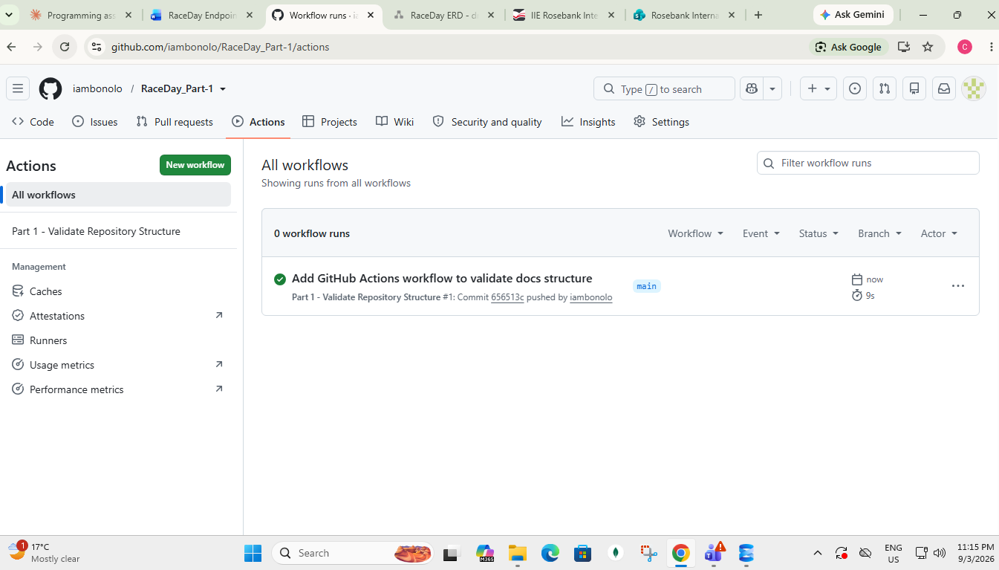

# RaceDay – Part 2: REST API

A RESTful API built with **ASP.NET Core 8 (C#)** for managing South African running, walking and cycling events. **Organisers** create events and categories and record race results. **Participants** enrol in events and view their own enrolments and results. Data is stored in **SQL Server** using **Entity Framework Core (Code-First)**.

**Student:** Bonolo Mogorosi (ST10062230) · Rosebank College · PROG6212 Programming 2B

## Video demonstration
[Watch the Part 2 demonstration on YouTube (unlisted)](https://youtu.be/xk-OizO49-k)

## Tech stack
- ASP.NET Core 8 Web API (controllers)
- Entity Framework Core 8 (Code-First migrations) with SQL Server
- Server-side sessions for authentication, with role-based authorisation
- PBKDF2-SHA256 password hashing (100,000 iterations, random salt per user)
- Swagger / OpenAPI (Swashbuckle) with XML documentation
- xUnit + `WebApplicationFactory` (SQLite in-memory) for tests
- GitHub Actions for CI

## Prerequisites
- Visual Studio 2022 with the **ASP.NET and web development** workload
- .NET 8 SDK
- SQL Server LocalDB (installed with Visual Studio) or any SQL Server instance

## Setup
1. Clone the repository:
   2. Open `Part2-API/RaceDay/RaceDay.sln` in Visual Studio.
3. Check the connection string in `RaceDay.Api/appsettings.json` (`ConnectionStrings:DefaultConnection`). The default uses LocalDB:
4.  Open **Tools → NuGet Package Manager → Package Manager Console**, set **Default project** to `RaceDay.Api`, and run:
      This creates the `RaceDayApiDB` database with the tables `Roles`, `Users`, `Events`, `Categories`, `Enrolments` and `Results`, and the two roles (Organiser, Participant).
5. Set `RaceDay.Api` as the startup project, choose the **https** profile, and press the green run button.
6. Swagger opens at `https://localhost:<port>/swagger` (the port is shown in the browser address bar).

## Roles and authentication
| Role | What they can do |
|---|---|
| **Organiser** | Create, update and delete their own events; add, update and delete categories; view enrolments for their events; record results |
| **Participant** | View events and categories; enrol in an event; view their own enrolments and results |

- A user chooses a role when registering (`"role": "Organiser"` or `"Participant"`). If the optional setting `Registration:OrganiserCode` is configured, Organisers must also supply that code.
- `POST /api/auth/login` creates a **server-side session** (cookie `.RaceDay.Session`, 30-minute idle timeout) that stores the user ID and role.
- Endpoints marked with a role return **401** when not logged in and **403** when logged in with the wrong role. Organisers can only change or delete events they created.
- Passwords are never stored in plain text and never returned by the API.

## Endpoints
| Method | Route | Access |
|---|---|---|
| POST | `/api/auth/register` | Public |
| POST | `/api/auth/login` | Public |
| POST | `/api/auth/logout` | Logged in |
| GET | `/api/users/me` | Logged in |
| PUT | `/api/users/me` | Logged in |
| GET | `/api/events` | Logged in |
| GET | `/api/events/{id}` | Logged in |
| POST | `/api/events` | Organiser |
| PUT | `/api/events/{id}` | Organiser (owner) |
| DELETE | `/api/events/{id}` | Organiser (owner) |
| GET | `/api/events/{eventId}/categories` | Logged in |
| POST | `/api/events/{eventId}/categories` | Organiser (owner) |
| PUT | `/api/categories/{id}` | Organiser (owner) |
| DELETE | `/api/categories/{id}` | Organiser (owner) |
| POST | `/api/events/{eventId}/enrolments` | Participant |
| GET | `/api/events/{eventId}/enrolments` | Organiser (owner) |
| GET | `/api/users/me/enrolments` | Participant |
| POST | `/api/enrolments/{id}/results` | Organiser (owner) |
| GET | `/api/users/me/results` | Participant |

Full request and response details, with example values and every status code, are in Swagger.

## Running the tests
In Visual Studio open **Test → Test Explorer** and click **Run All Tests**, or from the solution folder run:
There are **63 tests** covering registration, login and logout, session protection, role-based access (401/403), validation, duplicate handling (409), not-found cases (404), enrolments, results and password hashing. The integration tests run the real API against an in-memory SQLite database, so they do not touch your SQL Server data.

## CI/CD
The GitHub Actions workflow `.github/workflows/ci.yml` restores, builds and tests the solution on every push and pull request.

## Differences from the Part 1 plan
| Part 1 plan | Implemented | Reason |
|---|---|---|
| `POST /api/enrolements/{id}/results` | `POST /api/enrolments/{id}/results` | Spelling error in the Part 1 plan, corrected for consistency with the other enrolment routes |
| A few routes written without a leading `/` | All routes start with `/api/...` | Consistent routing |
| Not specified | `DELETE` on an event or category returns **409** if it still has categories or enrolments | Protects existing data and matches the database foreign keys |
| Not specified | A participant can enrol only once per event (**409** on repeat) | Matches the unique (participant, event) rule in the database |

---

# RaceDay — Part 1: System Planning

## System Description

RaceDay is a full-stack, web-based event management system built for the South African road running, walking, and cycling community. The platform replaces the paper-based registration, spreadsheets, and disconnected communication that many local race organisers currently rely on.

Event Organisers can create and manage events, define age/distance categories, and capture participant results. Participants can browse upcoming events, enter events by selecting a category, track their enrolment status, and view their personal race history once results are published.

This part of the project (Part 1) covers the planning phase only — no application code has been written. The deliverables are an Entity Relationship Diagram (ERD), a full API endpoint plan, and a SQL Server database script that creates and seeds the schema.

## User Roles

**Organiser**
- Creates, edits, and deletes events
- Manages age/distance categories for their events
- Views all enrolments for events they manage
- Captures finish times and finishing positions for participants after an event

**Participant**
- Registers for an account and logs in
- Browses upcoming events and available categories
- Enters an event by selecting a category
- Views their own enrolment status
- Tracks their personal race history and results once published

## Repository Structure

## Setup Instructions (Part 1)

1. Install SQL Server (Express or Developer edition) and SQL Server Management Studio (SSMS)
2. Open SSMS and connect to your local server instance
3. Open a new query window
4. Open `/docs/RaceDay Schema.sql`, copy its full contents, and paste into the query window
5. Execute the script (F5) — this creates the `RaceDayDB` database, all 6 tables, and seeds sample data
6. Confirm success via the Messages tab and by expanding `RaceDayDB > Tables` in Object Explorer

## CI/CD

 

## Video Walkthrough

 https://youtu.be/rciX57sJRKM
